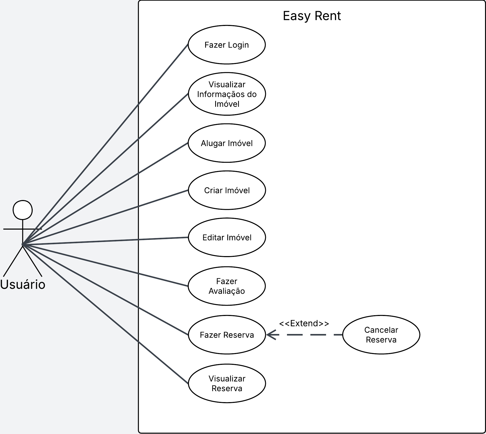
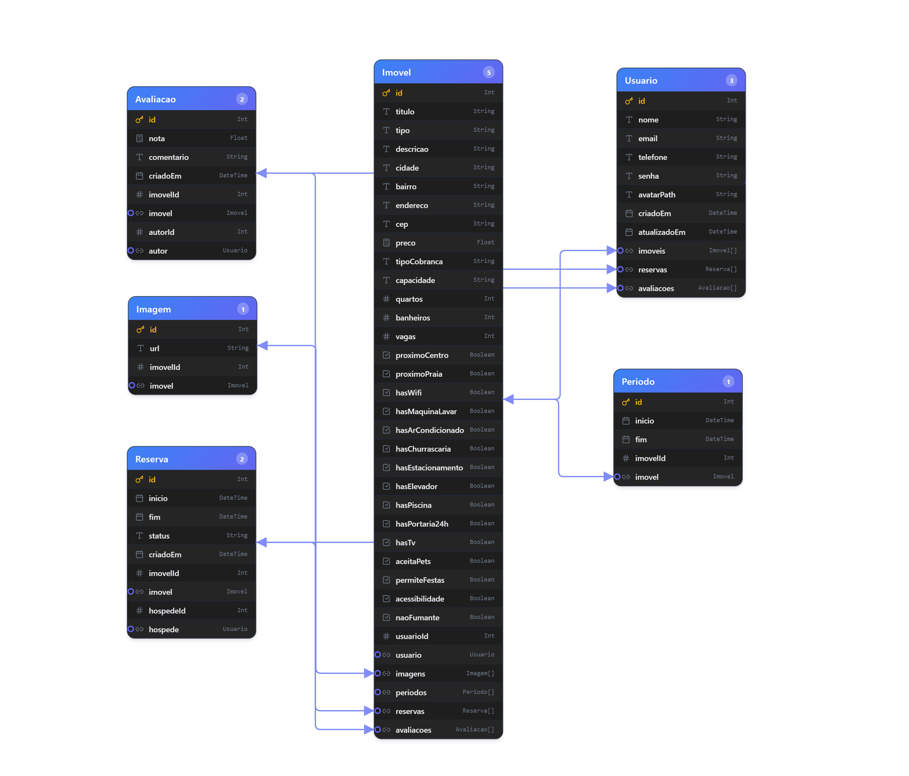
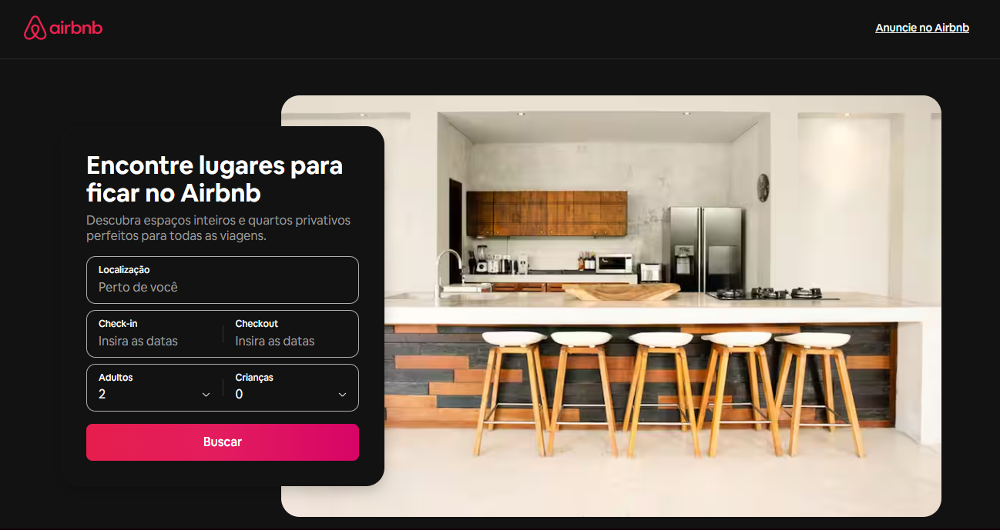

# Easy-Rent

## Discentes

Kauã Santos

## Easy-Rent

O Easy-Rent é uma plataforma desenvolvida para simplificar e modernizar o processo de gerenciamento de imóveis destinados à locação. O sistema foi criado com o objetivo de centralizar informações importantes relacionadas a imóveis, reservas e usuários, proporcionando uma experiência mais organizada, eficiente e segura para todas as partes envolvidas.

Através da plataforma, proprietários podem cadastrar e administrar seus imóveis de forma prática, mantendo informações atualizadas sobre disponibilidade, características, preços e histórico de reservas. Já os usuários interessados em alugar um imóvel podem realizar pesquisas, visualizar detalhes dos anúncios e efetuar solicitações de reserva por meio de uma interface intuitiva e acessível.

## Objetivo

O projeto tem como proposta o desenvolvimento de uma plataforma web voltada para o gerenciamento de locais destinados a aluguel. A ideia surgiu a partir da identificação de uma necessidade real de organização e controle dessas informações.

Como solução, propõe-se a criação de um site inspirado em plataformas de aluguel, no qual usuários poderão buscar e reservar locais disponíveis, enquanto os proprietários terão acesso a um dashboard de gerenciamento, permitindo acompanhar reservas, controlar informações dos imóveis, visualizar calendários de disponibilidade e gerenciar solicitações de forma centralizada.

O sistema também visa proporcionar uma experiência prática e intuitiva, promovendo maior eficiência na administração dos imóveis e facilitando o processo de locação para todos os usuários da plataforma.

## Publico Alvo

O público-alvo deste projeto é composto por pessoas que desejam alugar espaços temporariamente e por proprietários que buscam uma forma mais organizada de gerenciar seus imóveis disponíveis para locação. A plataforma é voltada para um público amplo, com faixa etária estimada entre 18 e 60 anos.

## Usos do sistema

* **Gerenciamento de Imóveis:** Permite aos proprietários cadastrar, visualizar, editar e remover imóveis disponíveis para locação. Possibilita o gerenciamento das informações do imóvel, como endereço, descrição, capacidade, valor da diária ou mensalidade, fotos e status de disponibilidade.

* **Gerenciamento de Reservas:** Permite aos usuários solicitar reservas de imóveis disponíveis e acompanhar o status de suas solicitações. Os proprietários podem aprovar, rejeitar ou cancelar reservas, mantendo um controle centralizado de todas as locações realizadas.

* **Controle de Disponibilidade:** Facilita o gerenciamento das datas disponíveis para locação por meio de um calendário integrado. Evita conflitos de agendamento e permite que proprietários visualizem períodos ocupados e livres de cada imóvel.

* **Pesquisa e Consulta de Imóveis:** Permite aos usuários pesquisar imóveis cadastrados na plataforma, visualizar detalhes, localização, imagens e informações relevantes para a tomada de decisão antes de realizar uma reserva.

* **Perfis de Usuários:** Oferece diferentes perfis de acesso para clientes, proprietários e administradores do sistema. Cada perfil possui permissões específicas, garantindo maior segurança e organização das funcionalidades disponíveis.

* **Dashboard Administrativo: ** Disponibiliza aos proprietários uma área de gerenciamento contendo informações sobre seus imóveis, reservas realizadas, solicitações pendentes e indicadores importantes para o acompanhamento das locações.

## Moneticação

O método de monetização pensado para a plataforma será a cobrança de uma pequena comissão sobre cada aluguel realizado pelo site. Sempre que um usuário efetuar a reserva e o pagamento de um imóvel, a plataforma ficará com uma porcentagem do valor da transação.

## Personas

Abaixo estão as personas identificadas para o sistema, representando tanto os proprietários/gestores de imóveis quanto o público final.

### 1. Juliana Oliveira (Proprietária/Gestora)
* **Idade:** 34 anos
* **Perfil:** Gestora de imóveis focada em centralização e eficiência operacional.
* **Objetivos:**
    * Expandir a visibilidade dos seus imóveis.
    * Simplificar o fluxo de gestão de reservas.
    * Eliminar conflitos de agendamento (overbooking).
    * Centralizar o controle de todos os ativos em uma única plataforma.
* **Dores:** Atualmente depende de processos manuais (planilhas e WhatsApp), o que causa desorganização no calendário de disponibilidade e perda de potenciais clientes devido à demora nas respostas.

### 2. Mariana Souza (Proprietária/Gestora)
* **Idade:** 25 anos
* **Perfil:** Gestora focada em organização sistêmica e agilidade no atendimento.
* **Objetivos:**
    * Unificar a gestão de diversos imóveis em um único sistema.
    * Obter uma visão clara em tempo real das reservas e níveis de ocupação.
    * Agilizar o tempo de resposta aos clientes.
    * Otimizar a organização geral do negócio.
* **Dores:** Enfrenta confusão operacional pelo uso de múltiplas ferramentas desconexas, dificuldade de monitoramento em tempo real e perda de oportunidades de negócio devido a processos manuais excessivamente lentos.

### 3. Lucas Martins (Usuário/Locatário)
* **Idade:** 26 anos
* **Perfil:** Cliente final em busca de praticidade, segurança e clareza na reserva de imóveis.
* **Objetivos:**
    * Encontrar rapidamente o local ideal para eventos ou estadias.
    * Acessar informações claras, fotos reais e descrições precisas antes de decidir.
    * Realizar reservas de forma rápida e segura.
    * Garantir a confiabilidade do local escolhido.
* **Dores:** Sente frustração ao perder tempo navegando por vários sites com informações incompletas ou enganosas, além de insegurança por falta de avaliações ou processos de reserva confusos e morosos.

## Requisitos de Sistema

### Sistemas Funcionais
* **RF01:** O sistema deve permitir que usuários realizem cadastro e login na plataforma.
* **RF02:** O sistema deve permitir que proprietários cadastrem casas disponíveis para aluguel.
* **RF03:** O sistema deve permitir que usuários visualizem informações detalhadas dos imóveis, como fotos, localização, preço e descrição.
* **RF04:** O sistema deve permitir que usuários pesquisem casas disponíveis para aluguel.
* **RF05:** O sistema deve permitir que usuários realizem reservas de imóveis pela plataforma.
* **RF06:** O sistema deve permitir que proprietários gerenciem suas casas cadastradas, podendo editar ou remover anúncios.
* **RF07:** O sistema deve permitir que proprietários visualizem e gerenciem reservas realizadas.
* **RF08:** O sistema deve permitir a visualização de disponibilidade das casas em um calendário.

### Sistemas não Funcionais
* **RNF01:** O sistema deve possuir interface simples e intuitiva, facilitando a navegação dos usuários.
* **RNF02:** O sistema deve garantir a segurança das informações dos usuários, protegendo dados pessoais e de login.
* **RNF03:** O sistema deve ser acessível por navegadores web modernos.
* **RNF04:** O sistema deve apresentar tempo de carregamento rápido das páginas.
* **RNF05:** O sistema deve ser responsivo, funcionando corretamente em computadores, tablets e celulares.
* **RNF06:** O sistema deve garantir disponibilidade contínua da plataforma, evitando quedas frequentes.

## Diagrama Casos de Usos

## Diagrama de Classes

## Tecnologias Utilizadas

* **React:** Utilizado para desenvolvimento do frontend, proporcionando uma experiência eficiente com renderização de componentes e suporte a interfaces dinâmicas.
* **Tailwind CSS:** Framework de estilização utilizado para criação de interfaces modernas, responsivas e com desenvolvimento mais rápido através de classes utilitárias.
* **Prisma:** ORM utilizado para facilitar a comunicação com o banco de dados, permitindo manipulação de dados de forma mais segura e estruturada.
* **GitHub:** Plataforma utilizada para controle de versão do código-fonte, colaboração em equipe e armazenamento do repositório do projeto.
* **Figma:** Ferramenta utilizada para criação e prototipação das interfaces do sistema, auxiliando no design e planejamento visual da aplicação.
* **Visual Studio Code (VSCode):** Editor de código utilizado no desenvolvimento do projeto, oferecendo suporte a extensões, depuração e produtividade.

## Bibliotecas do Projeto (Backend)

* **Express:** Framework utilizado para criação do servidor e gerenciamento das rotas da API.
* **Cors:** Permite o controle de acesso entre diferentes origens (frontend e backend).
* **Dotenv:** Utilizado para gerenciamento de variáveis de ambiente.
* **Multer:** Middleware responsável pelo upload de arquivos (como imagens de imóveis).
* **Prisma:** ORM utilizado para manipulação e consulta do banco de dados de forma estruturada e segura.
* **Nodemon:** Ferramenta de desenvolvimento que reinicia automaticamente o servidor a cada alteração no código.

## Bibliotecas do Projeto (Frontend)

* **React:** Biblioteca principal utilizada para construção da interface do usuário.
* **React DOM:** Responsável pela integração do React com o DOM do navegador.
* **React Router DOM:** Utilizado para gerenciamento de rotas e navegação entre páginas da aplicação.
* **React Icons:** Biblioteca de ícones para uso na interface.
* **Framer Motion:** Utilizado para animações e transições na interface.
* **Swiper:** Utilizado para criação de sliders/carrosséis de imagens.
* **React Datepicker:** Componente para seleção de datas (reservas).
* **Date-fns:** Biblioteca para manipulação e formatação de datas.
* **@radix-ui/react-slider:** Componente acessível de slider para inputs interativos.

## Histórias de Usuário

### I. Usuário buscando um imóvel para alugar
Como um usuário que está procurando um imóvel para alugar,  
Eu quero visualizar uma lista de imóveis disponíveis no Easy-Rent,  
Para que eu possa comparar opções e escolher a melhor alternativa para minha necessidade.

### II. Usuário interessado em um imóvel específico
Como um usuário interessado em um imóvel,  
Eu quero visualizar os detalhes completos do imóvel, incluindo fotos, descrição e valor,  
Para que eu possa tomar uma decisão mais informada antes de realizar uma reserva.

### III. Proprietário de imóveis
Como um proprietário de imóveis,  
Eu quero cadastrar novos imóveis no sistema com suas informações e disponibilidade,  
Para que meus imóveis possam ser anunciados e alugados de forma organizada.

### IV. Usuário realizando uma reserva
Como um usuário do sistema,  
Eu quero solicitar a reserva de um imóvel disponível,  
Para que eu possa garantir o aluguel do imóvel no período desejado.

### V. Administrador do sistema
Como um administrador do sistema,  
Eu quero gerenciar usuários e imóveis cadastrados,  
Para que eu possa garantir o funcionamento correto da plataforma e a organização dos dados.

## Interfaces de Usuário

As interfaces do sistema foram criadas a partir de um processo de design estruturado, iniciando pela definição da identidade visual da plataforma Easy-Rent. Nesse processo, foram selecionadas cores e elementos visuais com o objetivo de transmitir modernidade, confiabilidade e simplicidade, proporcionando uma experiência agradável e intuitiva para os usuários.

A proposta visual do sistema busca equilibrar clareza e funcionalidade, garantindo que tanto usuários quanto proprietários consigam navegar pelas funcionalidades de forma prática e eficiente. A interface foi pensada para facilitar o uso diário da plataforma, especialmente no gerenciamento de imóveis e reservas.

A página inicial do sistema apresenta uma visão geral do Easy-Rent, destacando suas principais funcionalidades, como busca de imóveis, gerenciamento de reservas e administração de propriedades. Essa abordagem permite que o usuário compreenda rapidamente o propósito da plataforma desde o primeiro acesso.

As demais telas do sistema incluem login, cadastro de usuários, visualização de imóveis, detalhes de propriedades, criação e gerenciamento de reservas, além do painel do proprietário. Todas as interfaces seguem um padrão visual consistente, garantindo unidade estética e facilidade de navegação em toda a aplicação.

## Análise de Concorrentes e Sistemas Similares

Para embasar o desenvolvimento da nossa plataforma, realizamos uma análise crítica das soluções já existentes no mercado, identificando as principais limitações enfrentadas pelos usuários:

## 1. Airbnb
Embora seja uma plataforma consolidada, apresenta barreiras significativas para novos usuários:
* **Desigualdade de visibilidade:** O algoritmo favorece excessivamente o status de "Superhost", prejudicando o alcance de novos anfitriões.
* **Priorização histórica:** Anúncios antigos e com grande volume de avaliações possuem prioridade automática nas buscas.
* **Barreira de entrada:** Novos anfitriões encontram dificuldades técnicas e de engajamento para ganhar tração inicial.
* **Transparência de preços:** Frequente divergência entre o valor exibido inicialmente e o preço final após taxas.

## 2. Zap Imóveis
Focada em anúncios imobiliários, a plataforma apresenta lacunas no processo de fechamento de negócio:
* **Ausência de reserva online:** Não oferece um sistema completo de fluxo de reserva integrado.
* **Dependência externa:** Todo o processo de conversão depende de contatos manuais (WhatsApp ou telefone), gerando atrito na experiência do usuário.
* **Manutenção de dados:** Persistência de anúncios de imóveis já negociados, comprometendo a precisão da plataforma.
* **Confiabilidade:** Risco elevado de contatos inválidos ou leads inexistentes.

### O Easy-Rent se diferencia como um sistema focado na gestão simplificada e centralizada de imóveis para locação, priorizando a organização entre proprietários e usuários da plataforma. Enquanto outras soluções do mercado, como grandes plataformas de aluguel, frequentemente apresentam excesso de funcionalidades, complexidade de uso ou dependência de intermediações externas, o Easy-Rent busca oferecer uma experiência mais direta, intuitiva e eficiente.
### A proposta do sistema é reduzir a complexidade no processo de locação, permitindo que proprietários tenham controle total sobre seus imóveis e reservas, enquanto usuários conseguem encontrar e reservar imóveis de forma rápida e clara. Essa abordagem prioriza a usabilidade, a organização das informações e a eficiência operacional.
### Apesar de ser uma plataforma mais enxuta em comparação a sistemas mais robustos do mercado, seus benefícios se refletem diretamente na experiência do usuário, tornando o processo de busca, reserva e gerenciamento de imóveis mais ágil, transparente e organizado.