# Easy-Rent

## Discentes

Kauã Santos

## Easy-Rent

O Easy-Rent é uma plataforma web desenvolvida para facilitar o processo de busca, reserva e gerenciamento de imóveis destinados à locação. O sistema permite que usuários anunciem seus imóveis e também realizem reservas, centralizando essas atividades em uma única plataforma.

Por meio de uma interface intuitiva, os usuários podem consultar imóveis, visualizar informações e disponibilidade, realizar reservas, efetuar pagamentos e manter contato com os anunciantes. A plataforma também oferece recursos de gerenciamento de imóveis, acompanhamento de reservas, avaliações e comunicação por chat.

## Objetivo

O projeto tem como objetivo oferecer uma solução web para simplificar e organizar o processo de locação de imóveis. A plataforma busca centralizar as principais etapas desse processo, desde a divulgação e consulta dos anúncios até a realização de reservas e pagamentos.

Além disso, o Easy-Rent procura proporcionar uma experiência prática tanto para quem anuncia imóveis quanto para quem deseja alugá-los, oferecendo ferramentas que facilitam o gerenciamento das propriedades, o controle de disponibilidade e a comunicação entre os usuários.

## Público Alvo

O público-alvo deste projeto é composto por pessoas que desejam alugar espaços temporariamente e por proprietários que buscam uma forma mais organizada de gerenciar seus imóveis disponíveis para locação. A plataforma é voltada para um público amplo, com faixa etária estimada entre 18 e 60 anos.

## Usos do sistema

* **Gerenciamento de Imóveis:** Permite aos usuários cadastrar, visualizar, editar e remover seus próprios imóveis, incluindo informações como endereço, descrição, capacidade, preço, fotos e disponibilidade.

* **Gerenciamento de Reservas:** Permite aos usuários realizar reservas e acompanhar seu andamento. Os anunciantes podem visualizar e gerenciar as reservas relacionadas aos seus imóveis.

* **Controle de Disponibilidade:** Disponibiliza um calendário para consulta dos períodos livres e ocupados, evitando conflitos entre reservas confirmadas.

* **Pesquisa e Consulta de Imóveis:** Permite pesquisar e visualizar imóveis cadastrados, incluindo fotos, localização, descrição, valores e demais informações relevantes.

* **Gerenciamento de Perfil:** Permite aos usuários visualizar e atualizar suas informações pessoais e dados de acesso.

* **Sistema de Pagamentos:** Integra a plataforma ao serviço Asaas, permitindo a realização de pagamentos por Pix, boleto bancário e cartão de crédito.

* **Chat:** Disponibiliza comunicação entre usuários e anunciantes, facilitando o esclarecimento de dúvidas e a negociação relacionada aos imóveis.

* **Avaliações:** Permite que usuários registrem avaliações sobre imóveis, contribuindo para a transparência e a confiança na plataforma.

## Monetização

O método de monetização pensado para a plataforma será a cobrança de uma pequena comissão sobre cada aluguel realizado pelo site. Sempre que um usuário efetuar a reserva e o pagamento de um imóvel, a plataforma ficará com uma porcentagem do valor da transação.

## Personas

Abaixo estão as personas identificadas para o sistema, representando tanto os proprietários/gestores de imóveis quanto o público final.

### 1. Juliana Oliveira (Proprietária/Gestora)
* **Idade:** 34 anos
* **Perfil:** Gestora de imóveis focada em centralização e eficiência operacional.
* **Objetivos:**
    * Expandir a visibilidade dos seus imóveis.
    * Simplificar o fluxo de gestão de reservas.
    * Eliminar conflitos de agendamento (overbooking).
    * Centralizar o controle de todos os ativos em uma única plataforma.
* **Dores:** Atualmente depende de processos manuais (planilhas e WhatsApp), o que causa desorganização no calendário de disponibilidade e perda de potenciais clientes devido à demora nas respostas.

### 2. Mariana Souza (Proprietária/Gestora)
* **Idade:** 25 anos
* **Perfil:** Gestora focada em organização sistêmica e agilidade no atendimento.
* **Objetivos:**
    * Unificar a gestão de diversos imóveis em um único sistema.
    * Obter uma visão clara em tempo real das reservas e níveis de ocupação.
    * Agilizar o tempo de resposta aos clientes.
    * Otimizar a organização geral do negócio.
* **Dores:** Enfrenta confusão operacional pelo uso de múltiplas ferramentas desconexas, dificuldade de monitoramento em tempo real e perda de oportunidades de negócio devido a processos manuais excessivamente lentos.

### 3. Lucas Martins (Usuário/Locatário)
* **Idade:** 26 anos
* **Perfil:** Cliente final em busca de praticidade, segurança e clareza na reserva de imóveis.
* **Objetivos:**
    * Encontrar rapidamente o local ideal para eventos ou estadias.
    * Acessar informações claras, fotos reais e descrições precisas antes de decidir.
    * Realizar reservas de forma rápida e segura.
    * Garantir a confiabilidade do local escolhido.
* **Dores:** Sente frustração ao perder tempo navegando por vários sites com informações incompletas ou enganosas, além de insegurança por falta de avaliações ou processos de reserva confusos e morosos.

## Requisitos do Sistema

### Requisitos Funcionais

* **RF01:** O sistema deve permitir que usuários realizem cadastro e login na plataforma.
* **RF02:** O sistema deve permitir que usuários visualizem e atualizem suas informações de perfil.
* **RF03:** O sistema deve permitir o cadastro de imóveis, incluindo fotos, descrição, localização, capacidade e preço.
* **RF04:** O sistema deve permitir que usuários visualizem, editem e removam seus próprios imóveis cadastrados.
* **RF05:** O sistema deve permitir a pesquisa e consulta de imóveis disponíveis para locação.
* **RF06:** O sistema deve permitir que usuários visualizem os detalhes e a disponibilidade dos imóveis.
* **RF07:** O sistema deve permitir a realização de reservas para períodos disponíveis.
* **RF08:** O sistema deve permitir que anunciantes visualizem e gerenciem as reservas de seus imóveis.
* **RF09:** O sistema deve controlar a disponibilidade dos imóveis, evitando conflitos entre reservas confirmadas.
* **RF10:** O sistema deve permitir a realização de pagamentos por Pix, boleto bancário e cartão de crédito, por meio da integração com o Asaas.
* **RF11:** O sistema deve atualizar automaticamente o status das reservas após a confirmação do pagamento.
* **RF12:** O sistema deve disponibilizar um chat para comunicação entre os usuários.
* **RF13:** O sistema deve permitir que usuários realizem avaliações dos imóveis.

### Requisitos Não Funcionais

* **RNF01:** O sistema deve possuir uma interface intuitiva e de fácil utilização.
* **RNF02:** O sistema deve garantir a segurança das informações dos usuários por meio de autenticação e proteção dos dados.
* **RNF03:** O sistema deve ser acessível por navegadores web modernos.
* **RNF04:** O sistema deve apresentar bom desempenho no carregamento das páginas e no processamento das requisições.
* **RNF05:** O sistema deve possuir uma interface responsiva, adaptável a computadores, tablets e celulares.
* **RNF06:** O sistema deve garantir a persistência das informações em banco de dados.
* **RNF07:** O sistema deve permitir a comunicação entre frontend e backend por meio de uma API.

## Diagrama de Casos de Uso
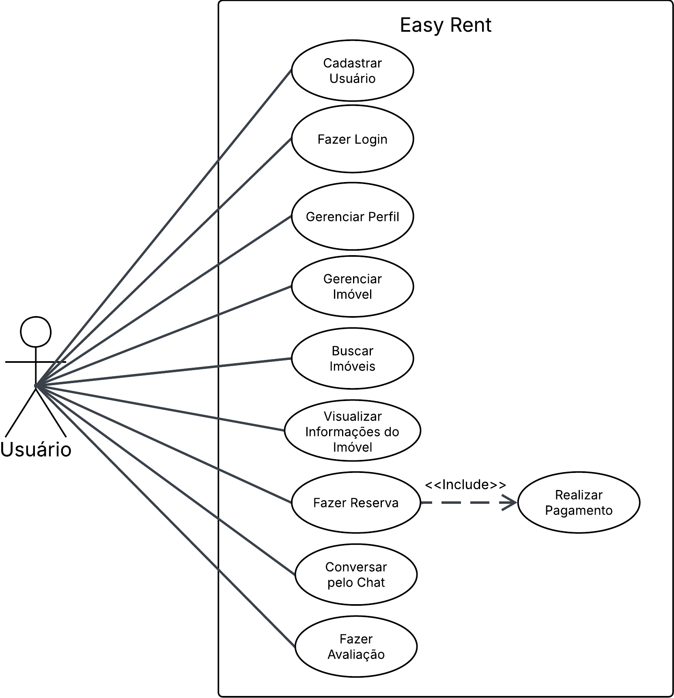

## Diagrama de Classes
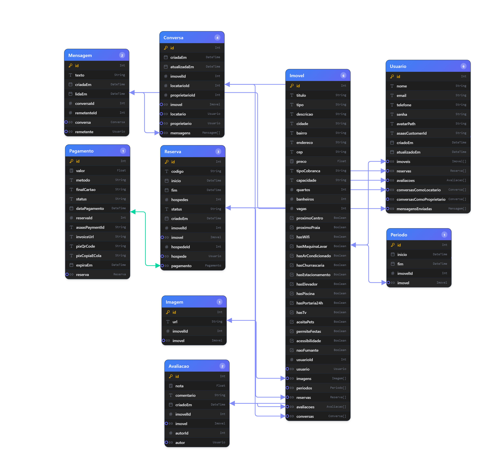

## Tecnologias Utilizadas

* **React:** Biblioteca utilizada para construção da interface do usuário.
* **Vite:** Ferramenta utilizada para configuração e execução do ambiente de desenvolvimento do frontend.
* **Tailwind CSS:** Framework utilizado para estilização e criação de interfaces responsivas.
* **Node.js:** Ambiente de execução utilizado no backend.
* **Express:** Framework utilizado para criação do servidor e gerenciamento das rotas da API.
* **Prisma:** ORM utilizado para facilitar a comunicação com o banco de dados.
* **PostgreSQL:** Sistema gerenciador de banco de dados utilizado para armazenar as informações da plataforma.
* **Socket.IO:** Tecnologia utilizada para implementar a comunicação em tempo real do chat.
* **Asaas:** Serviço integrado à plataforma para processamento de pagamentos.
* **Supabase:** Serviço utilizado em conjunto com seu SDK para integração com recursos de armazenamento.
* **GitLab:** Plataforma utilizada para armazenamento do repositório e controle de versão do projeto.
* **Figma:** Ferramenta utilizada para criação e prototipação das interfaces.
* **Visual Studio Code:** Editor de código utilizado durante o desenvolvimento.

## Bibliotecas do Projeto (Backend)

* **Express:** Gerenciamento do servidor e das rotas da API.
* **Cors:** Controle de acesso entre diferentes origens.
* **Dotenv:** Gerenciamento de variáveis de ambiente.
* **Multer:** Middleware responsável pelo recebimento de arquivos enviados pela aplicação.
* **Prisma e Prisma Client:** Ferramentas utilizadas para manipulação e consulta dos dados do banco.
* **Axios:** Realização de requisições HTTP, incluindo a comunicação com a API do Asaas.
* **Bcryptjs:** Criptografia de senhas.
* **Jsonwebtoken:** Geração e validação de tokens para autenticação.
* **Socket.IO:** Implementação da comunicação em tempo real.
* **Sharp:** Processamento e otimização de imagens.
* **Supabase JS:** SDK utilizado para integração com os serviços do Supabase.
* **Nodemon:** Reinicialização automática do servidor durante o desenvolvimento.

## Bibliotecas do Projeto (Frontend)

* **React e React DOM:** Construção e renderização dos componentes da interface.
* **React Router DOM:** Gerenciamento das rotas e navegação entre páginas.
* **React Icons:** Disponibilização de ícones para a interface.
* **Framer Motion:** Criação de animações e transições.
* **Swiper:** Criação de carrosséis e sliders de imagens.
* **React Datepicker:** Seleção de datas para as reservas.
* **Date-fns:** Manipulação e formatação de datas.
* **Radix UI Slider:** Componente de slider para elementos interativos.
* **React Hot Toast:** Exibição de notificações e mensagens ao usuário.
* **Socket.IO Client:** Comunicação em tempo real com o backend.

## Hospedagem e Banco de Dados

* **Vercel:** Hospedagem da aplicação frontend.
* **Render:** Hospedagem do servidor backend.
* **Neon:** Serviço utilizado para hospedagem do banco de dados PostgreSQL.

## Histórias de Usuário

### I. Usuário buscando um imóvel para alugar
Como usuário da plataforma,  
Eu quero visualizar e pesquisar imóveis disponíveis no Easy-Rent,  
Para que eu possa comparar opções e escolher a melhor alternativa para minha necessidade.

### II. Usuário interessado em um imóvel específico
Como usuário interessado em um imóvel,  
Eu quero visualizar seus detalhes, incluindo fotos, descrição, localização e valor,  
Para que eu possa tomar uma decisão antes de realizar uma reserva.

### III. Usuário anunciando um imóvel
Como usuário da plataforma,  
Eu quero cadastrar e gerenciar meus imóveis, incluindo informações e disponibilidade,  
Para que outras pessoas possam encontrá-los e realizar reservas.

### IV. Usuário realizando uma reserva
Como usuário da plataforma,  
Eu quero solicitar a reserva de um imóvel disponível para determinado período,  
Para que eu possa realizar a locação de forma organizada.

### V. Usuário realizando um pagamento
Como usuário com uma reserva pendente,  
Eu quero realizar o pagamento por meio de Pix, boleto ou cartão de crédito,  
Para que minha reserva seja confirmada após a aprovação do pagamento.

### VI. Usuário comunicando-se pelo chat
Como usuário interessado em um imóvel ou com uma reserva,  
Eu quero conversar com o anunciante por meio do chat,  
Para que eu possa esclarecer dúvidas e trocar informações.

### VII. Usuário avaliando um imóvel
Como usuário que realizou uma locação,  
Eu quero registrar uma avaliação sobre o imóvel,  
Para que outros usuários possam consultar experiências anteriores.

## Interfaces de Usuário

As interfaces do Easy-Rent foram desenvolvidas com foco na organização, simplicidade e facilidade de utilização. A identidade visual utiliza cores e elementos padronizados para proporcionar uma experiência consistente durante a navegação.

A página inicial apresenta a plataforma e permite que os usuários acessem a busca de imóveis. O sistema também conta com telas de cadastro e login, visualização de anúncios, detalhes dos imóveis e gerenciamento de propriedades.

Entre as demais interfaces estão as telas de criação e acompanhamento de reservas, calendário de disponibilidade, gerenciamento de pagamentos, perfil de usuário, avaliações e chat. Essas funcionalidades permitem que os usuários realizem diferentes atividades dentro de uma única plataforma, sem a necessidade de utilizar ferramentas externas para cada etapa do processo.

As interfaces foram organizadas para atender tanto às necessidades de quem anuncia imóveis quanto de quem deseja alugá-los, mantendo um padrão visual e uma navegação intuitiva em toda a aplicação.

## Testes e Avaliação de Desempenho

Para avaliar a qualidade e o desempenho do Easy-Rent, foram realizados testes utilizando as ferramentas Lighthouse e k6.

### Testes com Lighthouse

O Lighthouse foi utilizado para avaliar o desempenho, a acessibilidade e as boas práticas das interfaces da aplicação. Foram analisadas cinco telas: página inicial, listagem de imóveis, minhas reservas, cadastro de imóveis e pagamento.

Os resultados obtidos apresentaram pontuações superiores a 85 na categoria Performance em todas as telas avaliadas, indicando um bom desempenho no carregamento das páginas.

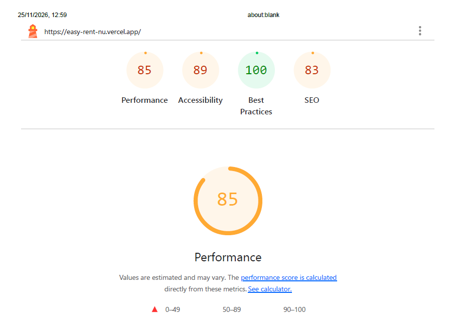

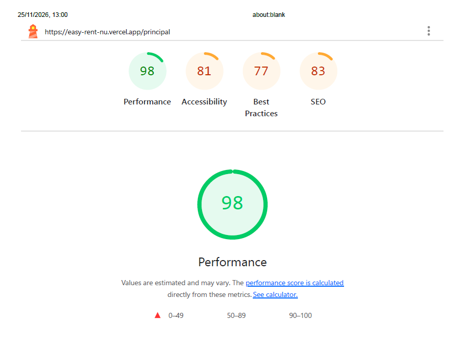

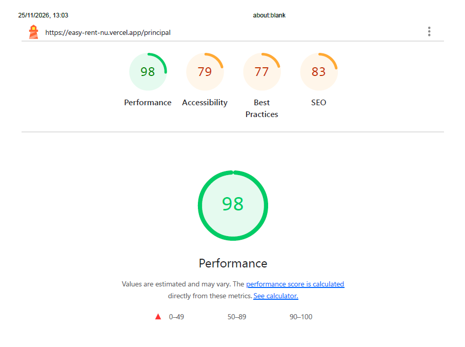

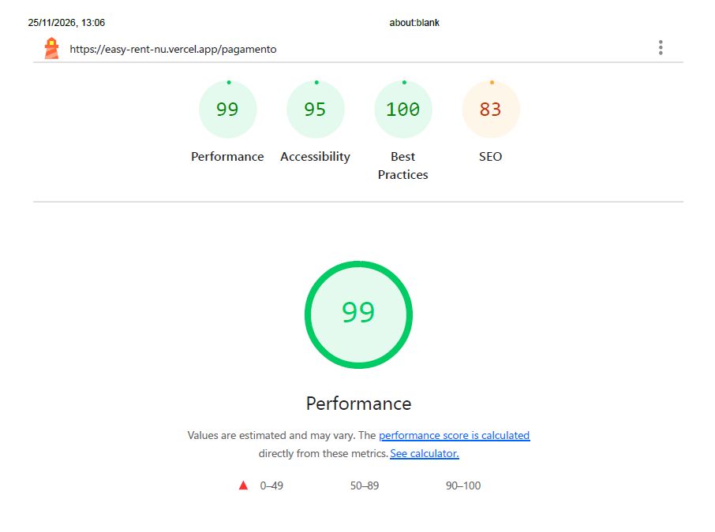

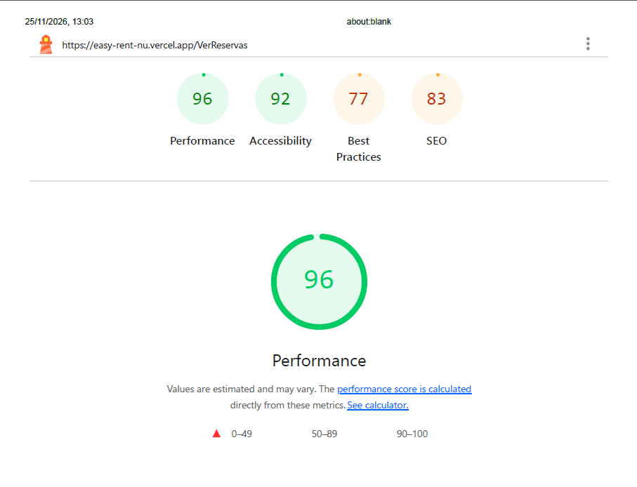

### Testes de Carga com k6

A ferramenta k6 foi utilizada para avaliar o comportamento da API diante de diferentes níveis de acesso simultâneo. Os testes foram realizados no endpoint de consulta de imóveis (`GET /api/imoveis`), utilizando diferentes quantidades de usuários virtuais.

Os resultados obtidos foram:

| Usuários virtuais | Requisições | Tempo médio | Sucesso |
|---:|---:|---:|---:|
| 1 | 5 | 1,36 s | 100% |
| 10 | 81 | 3,18 s | 100% |
| 25 | 80 | 8,96 s | 100% |

**Resultado do teste com 1 usuário virtual:**

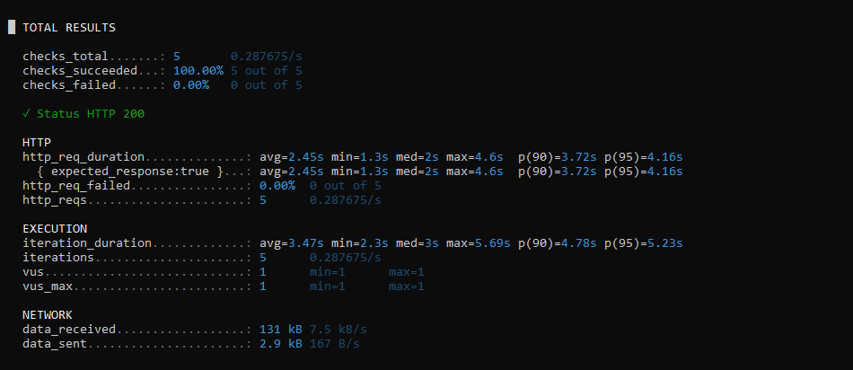

**Resultado do teste com 10 usuários virtuais:**

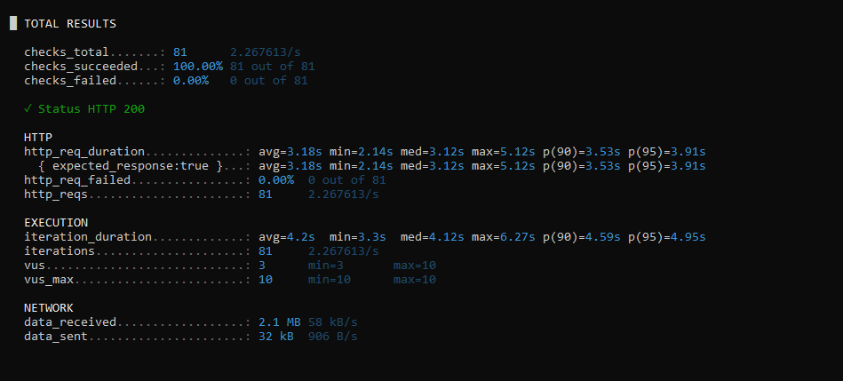

**Resultado do teste com 25 usuários virtuais:**

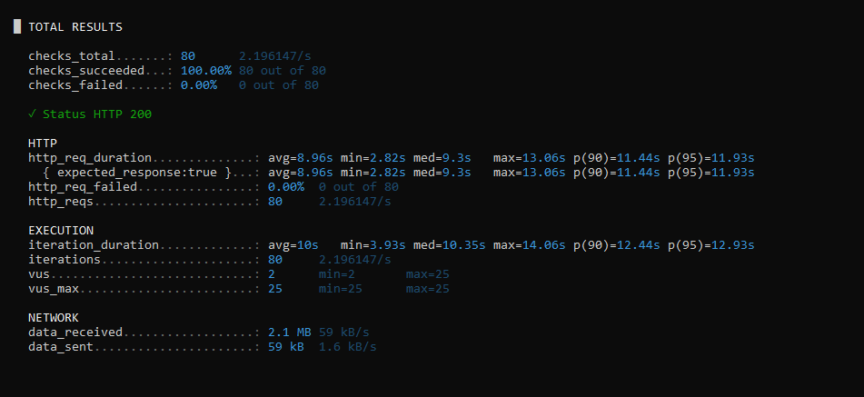

Os resultados demonstraram que todas as requisições foram concluídas com sucesso, sem falhas HTTP nos três cenários avaliados. Entretanto, foi observado um aumento no tempo médio de resposta conforme a quantidade de usuários simultâneos aumentou, passando de 1,36 segundo com um usuário para 8,96 segundos com 25 usuários.

## Análise de Concorrentes e Sistemas Similares

Para embasar o desenvolvimento da nossa plataforma, realizamos uma análise crítica das soluções já existentes no mercado, identificando as principais limitações enfrentadas pelos usuários:

## 1. Airbnb
Embora seja uma plataforma consolidada, apresenta barreiras significativas para novos usuários:
* **Desigualdade de visibilidade:** O algoritmo favorece excessivamente o status de "Superhost", prejudicando o alcance de novos anfitriões.
* **Priorização histórica:** Anúncios antigos e com grande volume de avaliações possuem prioridade automática nas buscas.
* **Barreira de entrada:** Novos anfitriões encontram dificuldades técnicas e de engajamento para ganhar tração inicial.
* **Transparência de preços:** Frequente divergência entre o valor exibido inicialmente e o preço final após taxas.

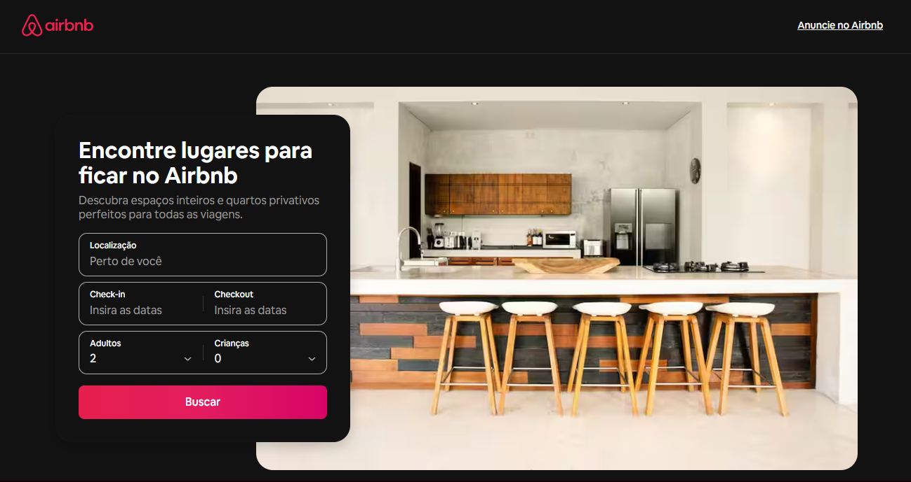

## 2. Zap Imóveis
Focada em anúncios imobiliários, a plataforma apresenta lacunas no processo de fechamento de negócio:
* **Ausência de reserva online:** Não oferece um sistema completo de fluxo de reserva integrado.
* **Dependência externa:** Todo o processo de conversão depende de contatos manuais (WhatsApp ou telefone), gerando atrito na experiência do usuário.
* **Manutenção de dados:** Persistência de anúncios de imóveis já negociados, comprometendo a precisão da plataforma.
* **Confiabilidade:** Risco elevado de contatos inválidos ou leads inexistentes.

### O Easy-Rent se diferencia como um sistema focado na gestão simplificada e centralizada de imóveis para locação, priorizando a organização entre proprietários e usuários da plataforma. Enquanto outras soluções do mercado, como grandes plataformas de aluguel, frequentemente apresentam excesso de funcionalidades, complexidade de uso ou dependência de intermediações externas, o Easy-Rent busca oferecer uma experiência mais direta, intuitiva e eficiente.
### A proposta do sistema é reduzir a complexidade no processo de locação, permitindo que proprietários tenham controle total sobre seus imóveis e reservas, enquanto usuários conseguem encontrar e reservar imóveis de forma rápida e clara. Essa abordagem prioriza a usabilidade, a organização das informações e a eficiência operacional.
### Apesar de ser uma plataforma mais enxuta em comparação a sistemas mais robustos do mercado, seus benefícios se refletem diretamente na experiência do usuário, tornando o processo de busca, reserva e gerenciamento de imóveis mais ágil, transparente e organizado.